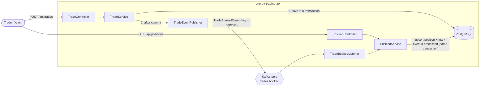

# Energy Trading API – Spring Boot 3 · Java 17 · Kafka · PostgreSQL · Docker

[](https://github.com/ayouamani/energy-trading-api/actions/workflows/ci.yml)


An **event-driven trade capture and position-keeping service** for power and gas, the kind of backend found in energy trading and banking front-to-back systems.

Traders book trades through a REST API. Each trade is stored in PostgreSQL, then published as an event on **Apache Kafka**. A consumer reads the stream and keeps the **net position** of every portfolio per commodity and delivery date up to date, with exactly-once effect even when Kafka redelivers a message.

## Highlights

- **Spring Boot 3.3 / Java 17**: records for DTOs and events, `jakarta.validation`, constructor injection, `Clock` injected for testable time.
- **Event-driven with Kafka**: events are published **after the database commit** (`@TransactionalEventListener(AFTER_COMMIT)`), so consumers never see a rolled-back trade. Messages are **keyed by portfolio** to keep ordering per portfolio.
- **Idempotent consumer**: Kafka delivers *at least once*, so the consumer records each `eventId` in the same transaction as the position update. A redelivered event is ignored (covered by an integration test).
- **Clean error contract**: every error is an RFC 7807 `application/problem+json` body (`ProblemDetail`).
- **Database migrations** with Flyway, schema checked by Hibernate at startup (`ddl-auto: validate`), optimistic locking on positions.
- **Testing pyramid**: plain unit tests for the domain, Mockito for services, `@WebMvcTest` for the HTTP contract, and an **end-to-end test with Testcontainers** on real PostgreSQL and Kafka.
- **Docker**: multi-stage image running as a non-root user, and a Docker Compose stack (app + PostgreSQL + Kafka in KRaft mode, no ZooKeeper).
- **CI with GitHub Actions**: build and test on every push, then start the Compose stack and run an HTTP smoke test against it.
- **OpenAPI / Swagger UI** and Actuator health probes.

## Architecture



## API

| Method | Endpoint | Description |
|---|---|---|
| `POST` | `/api/trades` | Book a trade, returns `201 Created` with a `Location` header |
| `GET` | `/api/trades/{id}` | Get a trade (`404` problem detail if unknown) |
| `GET` | `/api/trades?portfolio=PF-1` | Trades of a portfolio, most recent first |
| `GET` | `/api/positions?portfolio=PF-1` | Net positions per commodity and delivery date |
| `GET` | `/swagger-ui.html` | Interactive API documentation |
| `GET` | `/actuator/health` | Health (with liveness / readiness probes) |

### Example

```bash
curl -X POST http://localhost:8080/api/trades \
  -H 'Content-Type: application/json' \
  -d '{"portfolio":"PF-1","commodity":"POWER","direction":"BUY","quantityMwh":100,"priceEurPerMwh":80,"deliveryDate":"2027-01-15"}'

curl -X POST http://localhost:8080/api/trades \
  -H 'Content-Type: application/json' \
  -d '{"portfolio":"PF-1","commodity":"POWER","direction":"SELL","quantityMwh":30,"priceEurPerMwh":90,"deliveryDate":"2027-01-15"}'

curl 'http://localhost:8080/api/positions?portfolio=PF-1'
```

```json
[
  {
    "portfolio": "PF-1",
    "commodity": "POWER",
    "deliveryDate": "2027-01-15",
    "netQuantityMwh": 70.0000,
    "notionalEur": 5300.0000,
    "updatedAt": "2027-01-10T09:12:44.118Z"
  }
]
```

Invalid input returns a problem detail:

```json
{
  "type": "about:blank",
  "title": "Bad Request",
  "status": 400,
  "detail": "Invalid request content.",
  "instance": "/api/trades"
}
```

> Prices may be negative: negative power prices happen on European day-ahead markets when renewable production exceeds demand, so the API accepts them.

## Tech stack

| | |
|---|---|
| Language | Java 17 |
| Framework | Spring Boot 3.3 (Web, Validation, Data JPA, Actuator), Spring Kafka |
| Messaging | Apache Kafka 3.7 (KRaft) |
| Database | PostgreSQL 16, Flyway |
| API docs | springdoc-openapi (Swagger UI) |
| Tests | JUnit 5, AssertJ, Mockito, MockMvc, Testcontainers, Awaitility |
| Packaging | Docker (multi-stage, non-root), Docker Compose |
| CI | GitHub Actions |

## Run it

### With Docker only

```bash
git clone https://github.com/ayouamani/energy-trading-api.git
cd energy-trading-api
docker compose up --build
```

Then open http://localhost:8080/swagger-ui.html or run the end-to-end check:

```bash
./scripts/smoke-test.sh
```

### From your IDE / Maven

Requirements: JDK 17, Maven 3.9, Docker.

```bash
docker compose up -d postgres kafka   # infrastructure only
mvn spring-boot:run                   # app on http://localhost:8080
```

### Tests

```bash
mvn verify   # unit + web + Testcontainers integration tests (Docker must be running)
```

## Project structure

```text
src/main/java/com/amani/energytrading
├── trade/      # trade capture: entity, REST controller, service, Kafka publisher
├── position/   # Kafka consumer, idempotent position projection, REST controller
├── event/      # TradeBookedEvent (integration event shared by producer and consumer)
├── web/        # ProblemDetail error handling
└── config/     # topic declaration, Clock
src/main/resources
├── application.yml
└── db/migration/V1__create_trading_schema.sql
src/test/java/...  # PositionTest, PositionServiceTest, TradeServiceTest, TradeControllerTest, TradeFlowIntegrationTest
```

## Design choices and next steps

- **After-commit publishing vs transactional outbox**: publishing after commit guarantees that no event is sent for a rolled-back trade. If the broker is down at that exact moment the event is lost (it is logged). The production-grade next step is a **transactional outbox** (outbox table + relay or Debezium CDC).
- **Positions as a projection**: the read model is rebuilt from the event stream and could be moved to its own service without changing the producer.
- Next: trade amendments and cancellations, Avro + Schema Registry, a dead-letter topic, OAuth2 resource server, Prometheus metrics and a Kubernetes Helm chart.
